# 1. Identificação do trabalho

**a) Integrante**

Gabriel Rodrigues da Silva — RA 800277 (trabalho individual).

**b) Título do trabalho**

Dengue nos municípios brasileiros: casos notificados, clima e porte populacional.

Todo o código está no repositório <https://github.com/SEU-USUARIO/bdcd-trabalho01>.

\newpage

# Base de Dados 1 — InfoDengue (Fiocruz)

## a) Descrição do conjunto de dados

São os alertas semanais de dengue que o InfoDengue publica por município, de 2015 a 2024. Cada documento é uma semana epidemiológica e traz casos notificados, casos estimados, nível de alerta, Rt e as médias de temperatura e umidade. Coletei os 338 municípios com mais de 100 mil habitantes, o que deu 176.098 documentos.

## b) Nome do conjunto de dados

InfoDengue — Alerta de arboviroses por município (série `alertcity`, doença dengue), projeto da Fiocruz com a FGV.

## c) Link da base e do script de coleta

- Endpoint da API: <https://info.dengue.mat.br/api/alertcity>
- Script de coleta: <https://github.com/SEU-USUARIO/bdcd-trabalho01/blob/main/coleta/coleta_dengue.py>

A API atende um município por requisição, então o script pega a lista de geocodes acima de 100 mil habitantes (que vem da Base 2) e busca os dez anos de uma vez para cada um, em seis threads.

## d) Carga da base no MongoDB

Script de carga: <https://github.com/SEU-USUARIO/bdcd-trabalho01/blob/main/carga/carga_mongo.sh>

```bash
mongoimport --db dengue_br --collection alertas --drop --jsonArray --file dados/alertas.json
```

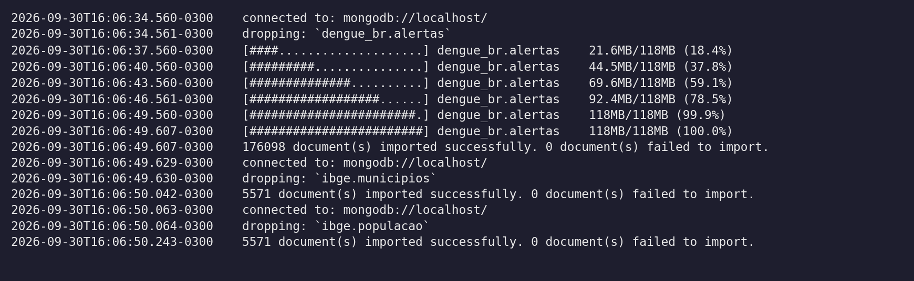{width=16cm}

## e) Listagem das collections criadas

```javascript
db.getSiblingDB("dengue_br").getCollectionNames()
```

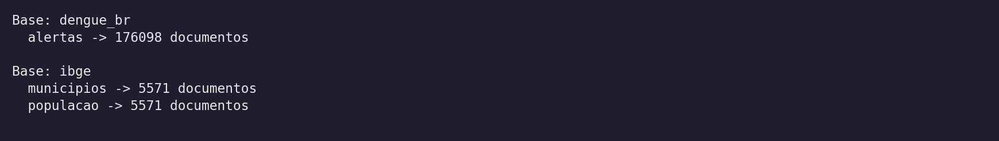{width=16cm}

## f) Consultas complexas

### Consulta 1 — Top 10 municípios por casos de dengue em 2024

**Objetivo:** ranquear os municípios com mais casos notificados em 2024 e comparar o peso real desses casos pela incidência por 100 mil habitantes, junto do número de semanas em que o município ficou no nível máximo de alerta.

```javascript
db.alertas.aggregate([
  { $match: { SE: { $gte: 202401, $lte: 202453 } } },
  { $group: {
      _id: "$geocode",
      municipio: { $first: "$municipio_nome" },
      casos: { $sum: { $ifNull: ["$casos", 0] } },
      populacao: { $max: "$pop" },
      semanas_alerta_vermelho: { $sum: { $cond: [{ $eq: ["$nivel", 4] }, 1, 0] } }
  } },
  { $project: {
      _id: 0, municipio: 1, casos: 1, populacao: 1, semanas_alerta_vermelho: 1,
      incidencia_100mil: { $round: [
        { $multiply: [{ $divide: ["$casos", "$populacao"] }, 100000] }, 1] }
  } },
  { $sort: { casos: -1 } },
  { $limit: 10 }
])
```

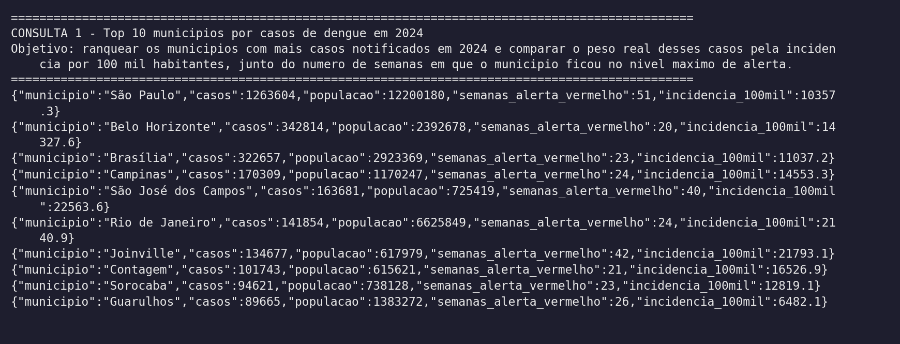{width=16cm}

O resultado mostra que ranquear por número absoluto engana: o Rio de Janeiro aparece no top 10 com 141 mil casos, mas tem a menor incidência da lista (2.140 por 100 mil), porque são 6,6 milhões de habitantes. São José dos Campos, com um décimo dessa população, tem incidência dez vezes maior e ficou 40 semanas em alerta vermelho.

### Consulta 2 — As 10 semanas epidemiológicas mais críticas

**Objetivo:** descobrir em que ponto do calendário a dengue pesa mais, cruzando a média de casos por semana epidemiológica com a temperatura média registrada e a quantidade de alertas no nível vermelho.

```javascript
db.alertas.aggregate([
  { $addFields: {
      ano: { $toInt: { $substrBytes: [{ $toString: "$SE" }, 0, 4] } },
      semana: { $mod: ["$SE", 100] }
  } },
  { $match: { ano: { $gte: 2015, $lte: 2024 }, semana: { $lte: 52 } } },
  { $group: {
      _id: "$semana",
      casos_medios: { $avg: { $ifNull: ["$casos", 0] } },
      temperatura_media: { $avg: "$tempmed" },
      alertas_vermelhos: { $sum: { $cond: [{ $eq: ["$nivel", 4] }, 1, 0] } }
  } },
  { $project: {
      _id: 0, semana_epidemiologica: "$_id", alertas_vermelhos: 1,
      casos_medios: { $round: ["$casos_medios", 1] },
      temperatura_media: { $round: ["$temperatura_media", 1] }
  } },
  { $sort: { casos_medios: -1 } },
  { $limit: 10 }
])
```

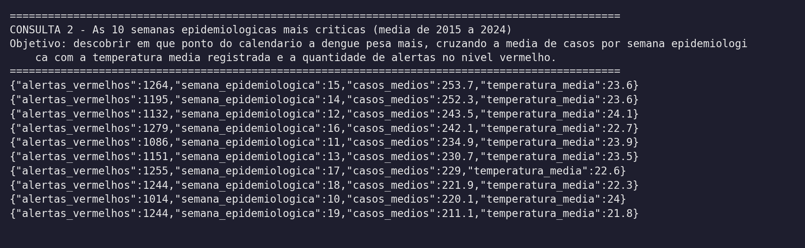{width=16cm}

As dez semanas mais críticas são todas entre a 10 e a 19, ou seja, de março a maio. O campo `SE` guarda ano e semana no mesmo número no formato AAAASS, então o `$mod` e o `$substrBytes` separam os dois dentro do próprio pipeline.

## g) Índice e plano de consulta

A consulta escolhida busca as semanas de 2024 de um município específico (São Paulo), que é o filtro mais comum nessa base:

```javascript
db.alertas.find({
  geocode: 3550308,
  data_iniSE: { $gte: ISODate("2024-01-01"), $lt: ISODate("2025-01-01") }
}).explain("executionStats")

db.alertas.createIndex({ geocode: 1, data_iniSE: -1 })
```

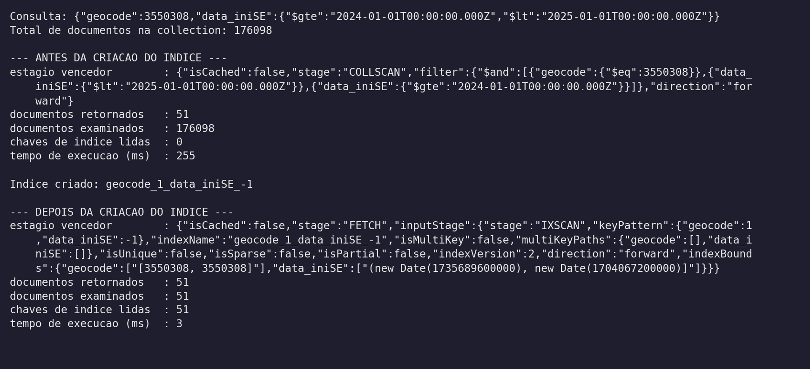{width=16cm}

**g1) Houve melhora na execução da consulta?**

Sim, e bastante. O tempo caiu de 255 ms para 3 ms, e os documentos examinados caíram de 176.098 para 51, que é exatamente o número de documentos retornados.

**g2) Por quê?**

Sem índice o Mongo faz COLLSCAN, ou seja, lê a collection inteira e testa o filtro em cada documento. Com o índice composto ele faz IXSCAN e vai direto no ramo do `geocode` 3550308, e como a data é a segunda chave o intervalo de 2024 já sai ordenado ali dentro.

## h) Conexão via Python com PyMongo

Notebook: <https://github.com/SEU-USUARIO/bdcd-trabalho01/blob/main/notebook/trabalho01.ipynb>

```python
from pymongo import MongoClient

cliente = MongoClient("mongodb://localhost:27017")
dengue = cliente["dengue_br"]
print(dengue.alertas.count_documents({}))
```

## i) Visualização dos dados

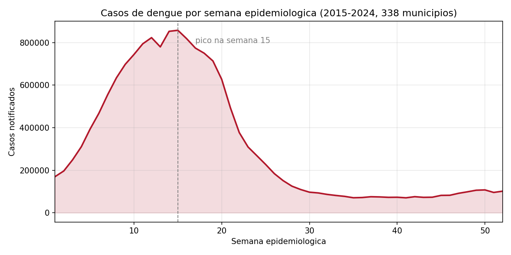{width=16cm}

**i1) Objetivo e conclusão:** mostrar a sazonalidade da dengue somando os casos de cada semana epidemiológica ao longo dos dez anos. Dá para concluir que a doença é fortemente concentrada no primeiro semestre: o pico está na semana 15 (abril) com 857 mil casos, e na semana 30 a curva já caiu para 97 mil, quase um nono do pico.

**i2) Atributos envolvidos:** `SE` (semana epidemiológica no formato AAAASS, de onde sai a semana) e `casos` (notificações da semana).

**i3) Código:** <https://github.com/SEU-USUARIO/bdcd-trabalho01/blob/main/notebook/trabalho01.ipynb>

\newpage

# Base de Dados 2 — IBGE

## a) Descrição do conjunto de dados

São os 5.571 municípios brasileiros com a hierarquia territorial completa do IBGE (região imediata, intermediária, UF e região) cruzados com a estimativa mais recente de população de cada um. Ficou em duas collections: `municipios`, com a divisão territorial, e `populacao`, com a estimativa populacional.

## b) Nome do conjunto de dados

IBGE — API de Localidades (municípios) e Tabela 6579 do SIDRA (População residente estimada).

## c) Link da base e do script de coleta

- API de Localidades: <https://servicodados.ibge.gov.br/api/v1/localidades/municipios>
- API do SIDRA: <https://apisidra.ibge.gov.br/values/t/6579/n6/all/v/all/p/last>
- Script de coleta: <https://github.com/SEU-USUARIO/bdcd-trabalho01/blob/main/coleta/coleta_ibge.py>

As duas APIs respondem tudo de uma vez, então o script só descomprime o gzip, descarta a linha de cabeçalho descritivo que o SIDRA manda na primeira posição e grava os dois JSON.

## d) Carga da base no MongoDB

Script de carga: <https://github.com/SEU-USUARIO/bdcd-trabalho01/blob/main/carga/carga_mongo.sh>

```bash
mongoimport --db ibge --collection municipios --drop --jsonArray --file dados/municipios.json
mongoimport --db ibge --collection populacao  --drop --jsonArray --file dados/populacao.json
```

O printscreen da carga é o mesmo do item (d) da Base 1, já que o script carrega as duas bases na sequência.

## e) Listagem das collections criadas

```javascript
db.getSiblingDB("ibge").getCollectionNames()
```

O printscreen é o mesmo do item (e) da Base 1: `ibge.municipios` com 5.571 documentos e `ibge.populacao` com 5.571 documentos.

## f) Consultas complexas

### Consulta 1 — Municípios e população por UF

**Objetivo:** juntar a hierarquia territorial do IBGE com a estimativa populacional para ver, por UF, quantos municípios existem, a população total e o porte médio do município.

```javascript
db.municipios.aggregate([
  { $lookup: { from: "populacao", localField: "id",
               foreignField: "geocode", as: "dados_populacao" } },
  { $unwind: "$dados_populacao" },
  { $group: {
      _id: "$regiao-imediata.regiao-intermediaria.UF.sigla",
      regiao: { $first: "$regiao-imediata.regiao-intermediaria.UF.regiao.nome" },
      municipios: { $sum: 1 },
      populacao_total: { $sum: "$dados_populacao.populacao" },
      populacao_media: { $avg: "$dados_populacao.populacao" }
  } },
  { $project: { _id: 0, uf: "$_id", regiao: 1, municipios: 1, populacao_total: 1,
                populacao_media: { $round: ["$populacao_media", 0] } } },
  { $sort: { populacao_total: -1 } },
  { $limit: 10 }
])
```

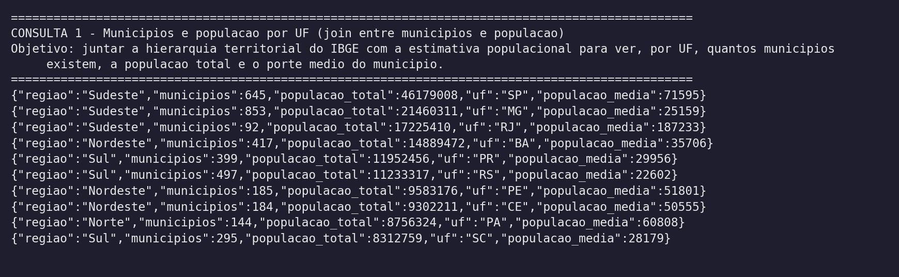{width=16cm}

O contraste entre SP e MG resume bem o resultado: Minas tem mais municípios (853 contra 645) e menos da metade da população, então o município médio mineiro tem 25 mil habitantes contra 71 mil do paulista.

### Consulta 2 — Os 3 municípios mais populosos de cada região

**Objetivo:** mostrar a concentração populacional dentro de cada região do país, comparando os três maiores municípios com o total da região.

```javascript
db.municipios.aggregate([
  { $lookup: { from: "populacao", localField: "id",
               foreignField: "geocode", as: "dados_populacao" } },
  { $unwind: "$dados_populacao" },
  { $group: {
      _id: "$regiao-imediata.regiao-intermediaria.UF.regiao.nome",
      populacao_regiao: { $sum: "$dados_populacao.populacao" },
      mais_populosos: { $topN: {
          n: 3,
          sortBy: { "dados_populacao.populacao": -1 },
          output: {
            municipio: "$nome",
            uf: "$regiao-imediata.regiao-intermediaria.UF.sigla",
            populacao: "$dados_populacao.populacao"
          }
      } }
  } },
  { $project: { _id: 0, regiao: "$_id", populacao_regiao: 1, mais_populosos: 1 } },
  { $sort: { populacao_regiao: -1 } }
])
```

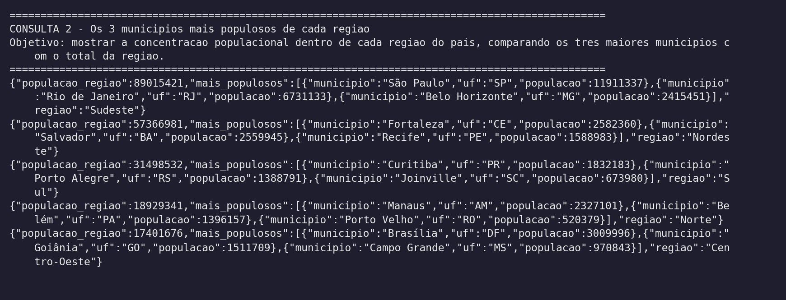{width=16cm}

O `$topN` resolve o ranking dentro de cada grupo sem precisar de um `$sort` global. O Norte é o caso mais desigual: Manaus sozinha tem 2,3 dos 18,9 milhões de habitantes da região.

## g) Índice e plano de consulta

A consulta escolhida é o próprio join da Consulta 1, que precisa casar o `id` do município com o `geocode` da população:

```javascript
db.municipios.explain("executionStats").aggregate([
  { $lookup: { from: "populacao", localField: "id",
               foreignField: "geocode", as: "dados_populacao" } },
  { $unwind: "$dados_populacao" },
  { $group: { _id: "$regiao-imediata.regiao-intermediaria.UF.sigla",
              municipios: { $sum: 1 },
              populacao_total: { $sum: "$dados_populacao.populacao" } } }
])

db.populacao.createIndex({ geocode: 1 })
```

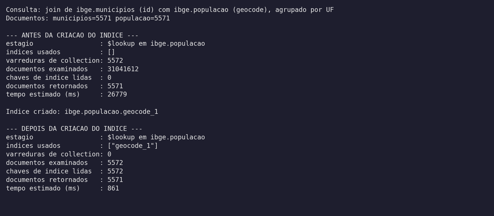{width=16cm}

**g1) Houve melhora na execução da consulta?**

Sim, foi a melhora mais dramática do trabalho. O tempo estimado do estágio `$lookup` caiu de 26.779 ms para 861 ms, e os documentos examinados caíram de 31.041.612 para 5.572.

**g2) Por quê?**

Sem índice em `populacao.geocode`, o `$lookup` varre a collection inteira uma vez para cada município da esquerda, o que dá as 5.572 varreduras e os 31 milhões de documentos examinados (5.572 × 5.571). Com o índice ele troca cada varredura por uma busca de uma chave só, então as varreduras vão a zero e sobra uma leitura por município.

## h) Conexão via Python com PyMongo

Notebook: <https://github.com/SEU-USUARIO/bdcd-trabalho01/blob/main/notebook/trabalho01.ipynb>

```python
from pymongo import MongoClient

cliente = MongoClient("mongodb://localhost:27017")
ibge = cliente["ibge"]
print(ibge.municipios.count_documents({}), ibge.populacao.count_documents({}))
```

## i) Visualização dos dados

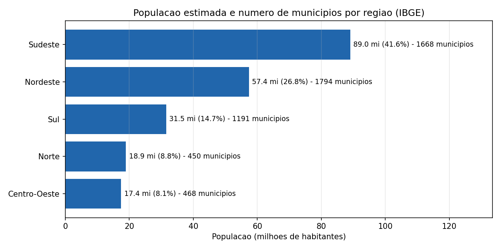{width=16cm}

**i1) Objetivo e conclusão:** comparar população e quantidade de municípios entre as cinco regiões. A conclusão é que as duas coisas não andam juntas: o Nordeste tem mais municípios que o Sudeste (1.794 contra 1.668) e 32 milhões de habitantes menos, e o Sudeste sozinho concentra 41,6% do país.

**i2) Atributos envolvidos:** `regiao-imediata.regiao-intermediaria.UF.regiao.nome` (região), `id` e `geocode` (chaves do join) e `populacao`.

**i3) Código:** <https://github.com/SEU-USUARIO/bdcd-trabalho01/blob/main/notebook/trabalho01.ipynb>

\newpage

# j) Referências

- InfoDengue. *API de dados — alertcity*. Fiocruz/FGV. <https://info.dengue.mat.br/services/api>
- Fiocruz. *Repositório de dados científicos*. <https://dados.fiocruz.br/>
- IBGE. *API de Localidades — Serviços de Dados*. <https://servicodados.ibge.gov.br/api/docs/localidades>
- IBGE. *SIDRA — Tabela 6579: População residente estimada*. <https://sidra.ibge.gov.br/tabela/6579>
- IBGE. *API do SIDRA — documentação de consulta*. <https://apisidra.ibge.gov.br/>
- MongoDB. *Aggregation Pipeline Stages*. <https://www.mongodb.com/docs/manual/reference/operator/aggregation-pipeline/>
- MongoDB. *Explain Results*. <https://www.mongodb.com/docs/manual/reference/explain-results/>
- MongoDB. *Indexes*. <https://www.mongodb.com/docs/manual/indexes/>
- MongoDB. *mongoimport*. <https://www.mongodb.com/docs/database-tools/mongoimport/>
- MongoDB. *PyMongo Documentation*. <https://pymongo.readthedocs.io/>
- Ministério da Saúde. *Semana epidemiológica — definição*. <https://www.gov.br/saude/pt-br/centrais-de-conteudo/publicacoes/boletins/epidemiologicos>
- RIBEIRO, M. X. *Slides da disciplina Bancos de Dados para Ciência de Dados*. UFSCar, 2026.

\newpage

# k) Relatório de Uso de IA

Ferramenta usada: Claude (modelo Opus) dentro do Cursor, no modo agente e no modo Ask.

## 1. Ferramentas e Escopo

Usei o Claude dentro do Cursor em três etapas específicas: montar os pipelines de agregação do `$lookup` e do `$topN`, escrever o laço paralelo que consulta a API do InfoDengue município por município, e ajustar os gráficos do matplotlib.

As outras etapas não passaram por IA. A escolha das bases, o recorte dos 338 municípios, os comandos de `mongoimport`, a decisão de qual índice criar e a leitura dos `explain` foram feitas na mão, porque aí o trabalho é entender o problema e não escrever código repetitivo.

## 2. Registro de Prompts e Interações

**Contextualização:** meu input foi o próprio PDF do enunciado anexado no chat mais uma explicação curta do que eu queria: duas bases públicas brasileiras, carga no Mongo local, e o que cada item de (a) a (k) precisava entregar. Também deixei claro o volume que eu esperava, porque isso muda o desenho da coleta.

**Refinamento:** nessa parte o prompt funcionou de primeira e não precisei corrigir a IA. Como o enunciado já vinha com os itens numerados e eu disse antes qual era o recorte e o ambiente (mongod local, sem Atlas), a resposta saiu no formato que eu esperava.

## 3. Descrição da Intervenção Humana

**Trechos escritos integralmente por mim**

- `municipios_acima_de()` em `coleta/coleta_dengue.py`: um `for` simples com um `if` no corte de população, montando a lista de geocodes.
- `carga/collections.js`: dois laços diretos percorrendo as bases e imprimindo a contagem de cada collection.
- O trecho do notebook que monta as listas `semanas` e `casos` com um `for` sobre o resultado da agregação, em vez de passar por um DataFrame do pandas.
- `validacao.py` inteiro, com as quatro funções de conferência descritas na seção 4.

**Trechos gerados pela IA e modificados por mim**

- `baixa_municipio()`: a versão sugerida era só um `urlopen` direto. Acrescentei as três tentativas com espera crescente e o retorno de lista vazia, porque a API do InfoDengue derruba conexão quando recebe muitas requisições seguidas.
- `prepara_documentos()`: a sugestão não tratava tipos. Acrescentei o campo `geocode` (a API não devolve ele isolado), a conversão do epoch em milissegundos para `Date` no Extended JSON e a tipagem de `pop` e das temperaturas, que vêm como string e travariam o `$avg`.
- Pipelines das consultas: troquei a chave de agrupamento de `municipio_nome` para `geocode` (nome de município repete entre UFs), acrescentei o `$ifNull` nos `$sum` por causa das semanas sem notificação e acrescentei o cálculo da incidência por 100 mil.
- `render_prints.py`: acrescentei o `parse_math=False`, senão o matplotlib tentava interpretar os `$` dos operadores do Mongo como fórmula e quebrava, e o `expandtabs` por causa dos tabs do `mongoimport`.
- Gráficos: troquei os rótulos para português, acrescentei a marcação da semana de pico e os percentuais nas barras das regiões.

**Integração na arquitetura**

O sistema é um pipeline linear: os scripts de coleta gravam JSON em `dados/`, o `carga_mongo.sh` importa esses arquivos para as duas bases do Mongo, e a partir daí consultas e notebook só leem o banco. Como cada etapa entrega um arquivo, as funções geradas pela IA ficam isoladas dentro de uma etapa só, e trocar uma delas não afeta as outras.

## 4. Validação e Testes

Não bastava o gráfico parecer certo, então escrevi o `validacao.py` para conferir número contra número. O teste mais forte compara a soma dos `casos` de todas as semanas de um município com o campo `notif_accum_year` que a própria API devolve: os dois bateram exatamente nos quatro municípios testados.

O segundo teste recalcula a incidência na mão (`casos / pop * 100000`) e compara com o `p_inc100k` que o InfoDengue já traz, numa amostra de 2.000 semanas com casos. Deu zero divergência acima de 0,01, o que confirma que a conversão de tipos da coleta não corrompeu nada.

Do lado do IBGE, conferi que nenhum dos 5.571 municípios ficou sem par no `$lookup` e que a soma das populações dá 214.211.951 habitantes, valor compatível com a estimativa do país. Também comparei a contagem de documentos importados com a contagem dos arquivos coletados, para garantir que o `mongoimport` não perdeu linha.

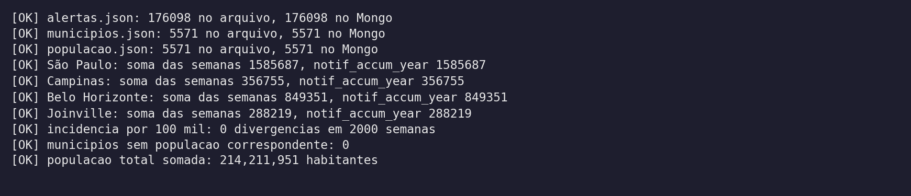{width=16cm}

Esse teste de `notif_accum_year` foi justamente o que me fez descobrir que o campo, apesar do nome, acumula toda a janela pedida na API e não o ano calendário. Além dos testes, uso bastante o modo Ask do Cursor para perguntar sobre trechos que não escrevi, principalmente para entender o que cada campo do `explain` significa antes de afirmar que o índice melhorou a consulta.
